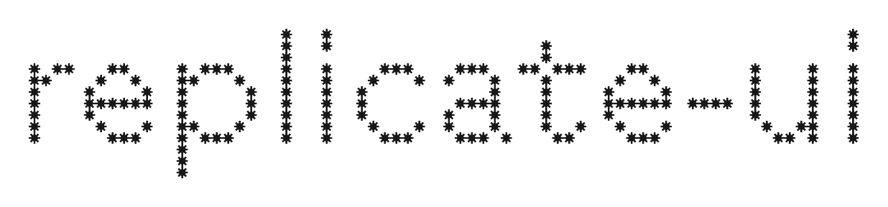

<p align="center">
  <picture>
    <source media="(prefers-color-scheme: dark)" srcset="assets/logo-dark.png">
    
  </picture>
</p>

<p align="center">
  Point Claude at any website. It crawls every page template, measures the whole design system and every hover, tap and scroll animation, writes the spec, rebuilds it in that exact style, then checks its own work against the original.
</p>

<p align="center">
  <a href="#install">Install</a> ·
  <a href="#commands">Commands</a> ·
  <a href="#how-it-works">How it works</a> ·
  <a href="#what-you-get">What you get</a> ·
  <a href="#boundaries">Boundaries</a>
</p>

---

Most "copy this design" attempts look at one screenshot of a home page and guess. replicate-ui measures instead:

- **Every template, not just the home page.** It reads the sitemap and the nav, groups pages into templates (`/products/a` and `/products/b` are one) and captures one of each. A 400-product store costs the same as a six-page portfolio.
- **Real numbers.** Colours are weighted by how much of the page they cover. The type scale comes from computed styles, the tokens from the site's own `:root` variables, and every `@font-face` is listed.
- **Every interaction.** A real mouse hovers each component type once, and the crawler diffs the computed styles before and after. A touch emulator taps menus and accordions on phone. It records scroll reveals, scrubbed and pinned motion, `@keyframes` and page transitions.
- **Efficient.** One headless browser, one pass, about 30 to 90 seconds. The result is a single `summary.md` that Claude reads first, and it opens only the screenshots that summary points to.
- **Closes the loop.** It crawls your build with the same script and diffs the two runs, so "looks close" becomes a score: how many of the reference's top values the build actually uses.

## Install

### Claude Code (plugin)

```bash
claude plugin marketplace add nickwechols/replicate-ui
claude plugin install replicate-ui@replicate-ui
```

Or inside a session: `/plugin marketplace add nickwechols/replicate-ui`, then `/plugin install replicate-ui@replicate-ui`.

The crawler needs Node 18 or later and Playwright with Chromium. ffmpeg is optional; it makes the motion contact sheets and video poster frames.

```bash
npm i -g playwright && npx playwright install chromium
brew install ffmpeg        # optional, macOS
```

### Claude apps (claude.ai, desktop)

Download `claude-ai/replicate-ui.zip` from this repo and upload it under **Settings → Capabilities → Skills**. It is the same skill with the scripts bundled. Live-site crawls need a code-execution environment that can reach the site; otherwise Claude falls back to the browser path or to screenshots you give it.

## Commands

| Command | What it does |
|---|---|
| `/replicate-ui:replicate <url> [what to build]` | The full run: crawl, Design DNA, build in the style, crawl the build, compare and fix. |
| `/replicate-ui:capture <url>` | Crawl and report the system. Nothing is built. |
| `/replicate-ui:dna <url \| capture folder \| screenshots>` | Write the full Design DNA spec. |
| `/replicate-ui:compare <build url>` | Crawl your local build, diff it with the reference capture, and fix the biggest gaps. |

Claude also picks up `replicate` by itself when you share a site and say something like "make it look like this".

Examples:

```text
/replicate-ui:replicate https://example-studio.com build a pricing page for my app in this style
/replicate-ui:capture https://example-shop.com --max 20
/replicate-ui:compare http://localhost:5173
```

## How it works

```
 discover            template-group          capture (per template, one browser)          summarise
 ─────────           ──────────────          ───────────────────────────────────          ─────────
 robots.txt   ──►    /                ──►    desktop 1440: video, fold + full shots,  ──► summary.md
 sitemaps            /work            ──►      tokens from computed styles, HTML,          data.json
 nav + footer        /work/*  (1 of 38)        real hovers with style diffs              shots/ video/ html/
 links               /about                  phone 390 (touch): shots, taps on toggles
                                             stylesheets once: :hover/:focus/:active,
                                               @keyframes, breakpoints, @font-face
                                             stack fingerprint + page transition probe
```

Then Claude:

1. reads `summary.md` and looks only at the images it points to;
2. writes `design-dna.md`, a 12-section spec with every value marked measured or inferred;
3. builds tokens first, then components with every state, then the templates;
4. crawls the build and runs `compare-captures.cjs`;
5. fixes what is missing, biggest first.

### Crawler options

```bash
node scripts/capture-site.cjs <url> [options]
```

| Option | Default | Use |
|---|---|---|
| `--out <dir>` | `site-capture` | Output folder. |
| `--max <n>` | `14` | Cap on pages captured. |
| `--per-template <n>` | `1` | Pages captured per repeated template. |
| `--pages /a,/b` | | Force-include pages the crawl might not find. |
| `--list` | | Print the planned pages and exit. |
| `--only /a,/b` | | Capture just these pages from the plan. |
| `--budget <s>` | | Stop starting new pages after N seconds and list what is left. |
| `--concurrency <n>` | `3` | Pages in parallel. |
| `--no-video` | | Skip recordings and contact sheets. |

Sandboxes that kill processes between commands, or that cap each command's time, can crawl in batches: run `--list`, then `--only ... --budget 170 --out cap-1`, then the next batch.

## What you get

```
site-capture/
  summary.md     pages, stack, fonts, type scale, colour/radius/shadow/spacing tallies, transitions,
                 :root variables, breakpoints, measured hovers, scroll reveals, scrub/pin candidates,
                 taps, @keyframes, every :hover/:focus/:active rule, section rhythm per page
  data.json      the same, unrounded (input for compare-captures.cjs)
  shots/         fold + full screenshots (desktop, phone), hover on/off crops, tap mid/open frames,
                 video poster frames
  video/         per-page .webm, entrance contact sheet (8 fps), whole-pass contact sheet (2 fps)
  html/          rendered markup per page, scripts stripped
design-dna.md    the spec
compare.md       the build-vs-reference score
```

A real summary from a test site is in [examples/sample-summary.md](examples/sample-summary.md).

## Boundaries

replicate-ui copies **style and interaction design**, not brands.

- It does not copy logos, wordmarks, illustrations, product photography, videos or proprietary icon sets. Builds use placeholders or original assets in the same style.
- It never builds pages that could pass as someone's real product, login or checkout. The crawler skips cart, checkout, account and login routes.
- It crawls politely: one page per template, a page cap, low concurrency, and nothing behind a sign-in.
- Paid fonts are named and swapped for the closest free match unless you own a license.
- Captures are local study material. Do not redistribute them.

## Troubleshooting

| Problem | Fix |
|---|---|
| `Host system is missing dependencies to run browsers` | Run `npx playwright install-deps`. Without sudo, see [reading-a-capture.md](plugins/replicate-ui/references/reading-a-capture.md#troubleshooting). |
| Hero or cards are blank in screenshots | They are MP4 videos, which headless Chromium cannot play. Install ffmpeg for poster frames. |
| The crawl stops partway | Use `--list` and batches with `--only` and `--budget`. |
| Connection reset | The environment's network allowlist blocks the site. Run it on your own machine. |

## Works well with

- A frontend-taste skill (for example [taste-skill](https://github.com/Leonxlnx/taste-skill)) for states and screens the reference does not show.
- A motion-study skill for deep work on scroll choreography.

Both are optional.

## Contributing

Issues and PRs are welcome, especially new stack fingerprints and better template grouping. Run `tools/build-claude-ai.sh` after editing the plugin so the claude.ai zip stays in sync.

## License

[MIT](LICENSE) © 2026 Nick Echols
